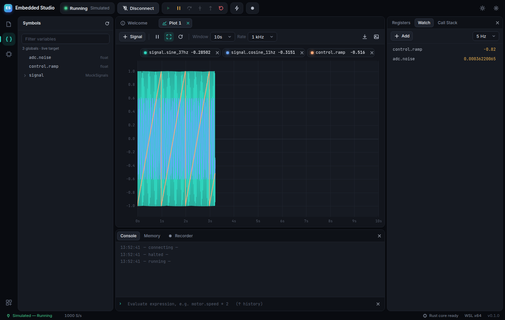
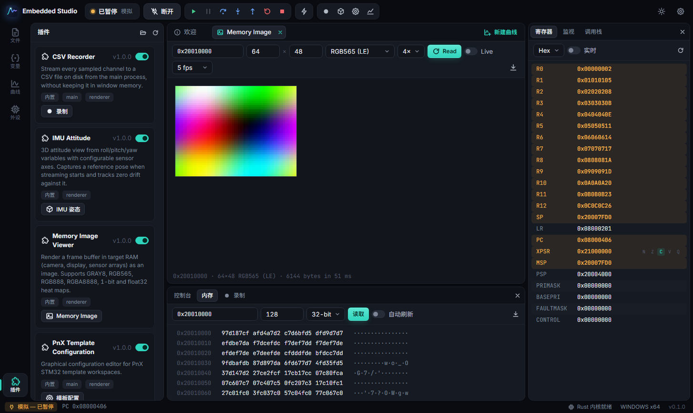
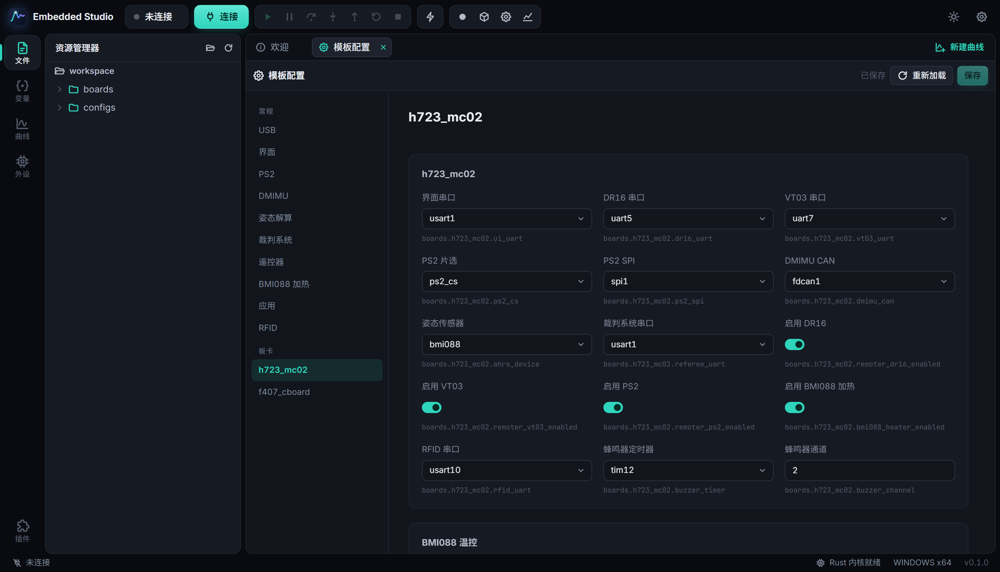
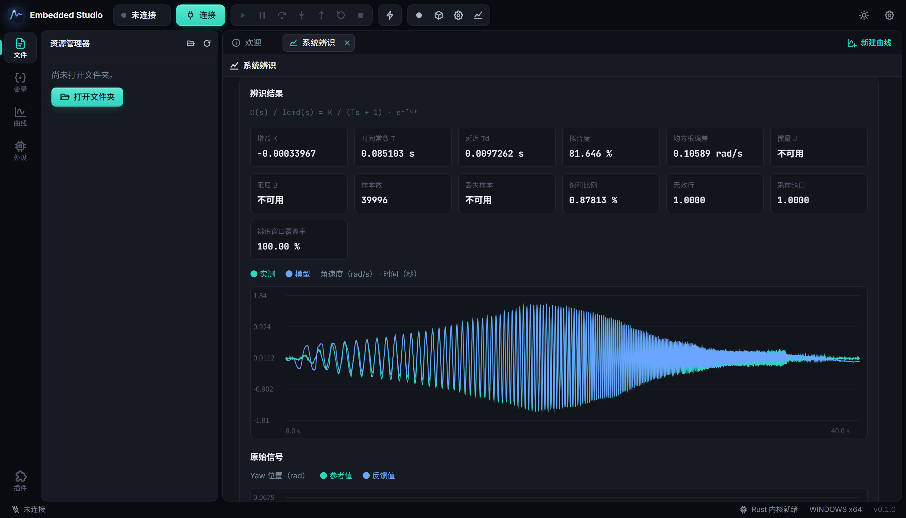

# PNX Studio

嵌入式调试工作台：Electron 界面 + Rust 探针内核，通过 **DAPLink / CMSIS-DAP** 与 **ST-Link** 连接 Cortex-M 目标，提供寄存器查看、实时曲线和源码级单步调试。支持 Windows、macOS、Linux 与 WSL 2。

通用功能由核心提供，PnX STM32 模板配置和云台系统辨识等功能通过内置插件扩展。Rust 探针内核使用 probe-rs 0.31 和 CMSIS-DAP 批量传输补丁。





## 功能

| 区域 | 功能 |
| --- | --- |
| 连接 | 扫描探针（CMSIS-DAP / DAPLink / ST-Link / J-Link），芯片型号自动补全（probe-rs 内置全部目标），SWD/JTAG、时钟、复位下连接；三种模式：**调试**（可选先烧录 → 复位 → 保持运行；不勾选烧录则附加不打断运行）、**启动**（可选先烧录 → 复位 → 运行到 `main`）、**监视**（只读采样，绝不暂停或写入目标）；镜像未变化时自动跳过擦写；会话中点击“烧录”会重启会话再烧录，暂停状态下也能烧录新固件并重新加载符号；内置**模拟目标**，无硬件也能体验主要调试视图 |
| 寄存器 | 内核寄存器 R0–R12/SP/LR/PC/xPSR/MSP/PSP/特殊寄存器，单步后高亮变化，xPSR 标志位解码，Hex/Dec/Bin 切换，可选实时轮询 |
| 外设 | 加载 CMSIS-SVD，按外设/寄存器筛选，读取并按位域解码，位图显示，双击编辑寄存器或位域（读-改-写），1 位字段双击翻转 |
| 曲线 | 从 ELF 的 DWARF 中选择全局变量，最高数十 kHz 流式采样；点击图例中的色条更改曲线颜色；同一页内可放多个曲线并拖动排布（拖到边缘拆分、拖到中间交换、拖动分隔条调整大小，网格/堆叠/并排预设），同步时间轴时作为子图（subplot）显示：只有最底部显示时间轴、子图工具栏收起为悬停按钮，暂停/时间窗/采样率在画布工具栏统一设置，整体导出为一个 CSV（统一时间列）和一张 PNG；多曲线页、拖拽添加、min/max 抽稀保证尖峰可见、十字光标读数、滚轮缩放时间窗、Shift+滚轮缩放 Y、拖动回看、暂停、CSV/PNG 导出 |
| 调试 | 继续/暂停/单步跳过/进入/跳出/复位；源码视图（大文件虚拟滚动、语法高亮、行号区断点、PC 行标记、暂停时悬停求值）；调用栈；DWARF 路径与本地工程路径自动对应（编译机路径不同也能找到源文件） |
| 监视 / 内存 / 控制台 | 变量监视（双击写入，可直接添加结构体/数组并展开成员；变量分组，可按分组或单个变量暂停采样而保留在列表中，行可在分组间拖动）、内存十六进制视图（8/16/32 位、变化高亮、自动刷新）、表达式求值控制台 |
| 体验 | 7 种颜色主题（Embedded 深色/浅色、VS Code Dark/Light Modern、GitHub Dark / Dark Dimmed / Light，设置中预览切换，工具栏按钮在同系列深浅间切换），中英文界面，命令面板 `Ctrl/Cmd+Shift+P`，可调整布局并记忆，工作区级配置（连接参数、曲线、监视、SVD）自动保存 |

内置插件：

- **Memory Image Viewer**：把目标 RAM 中的帧缓冲（摄像头、显示屏、传感器阵列）按 GRAY8 / RGB565 / RGB888 / RGBA8888 / 1-bit / float32 热力图绘制成图像，可实时刷新、导出 PNG。
- **IMU Attitude**（顶部工具栏立方体图标打开）：手动选择 Roll / Pitch / Yaw 变量（可自动识别），按传感器轴映射（默认前 X、左 Y、上 Z，可调）显示 3D 姿态；开始采样时记录初始位姿作为参考，实时显示各轴 Δ、零漂速率（°/min，最小二乘拟合）和漂移曲线，可随时重新记录零点。模拟目标自带 `imu` 结构体用于体验。
- **CSV Recorder**：在“录制”面板中选择要录制的变量（+ 添加或从「变量」/「监视」拖入），录制器自行保持这些变量的采样并只写这些列；不选则录制所有正在采样的通道。在主进程中直接写入 CSV 文件，长时间记录不占用窗口内存。
- **PnX Template Configuration**：打开 PnX STM32 模板工程后，点击工具栏的模板配置按钮或在命令面板运行“打开模板配置”，按模块和板卡编辑 `configs/user_config.json`。板卡资源从工程中的板级定义读取；保存时检查参数、资源冲突及文件是否被外部修改，并保留未知字段。保存只更新 JSON，构建工程时会重新生成配置头文件；也可在工程目录执行 `cmake -P configs/scripts/generate_config.cmake`。模板脚本是最终校验依据。
- **Gimbal System Identification**：在命令面板运行“打开系统辨识”，或通过工具栏进入。插件支持分析已有的 Auto-ID V1 `raw.csv`，也支持选择串口和新的输出文件，启动 Yaw 轴实验；在线模式需要目标固件实现 `AUTO_ID_START` / `AUTO_ID_ABORT` 协议，默认 921600 波特，PnX STM32 模板默认不包含该协议。实验会驱动云台运动约 40 秒；中止按钮和关闭视图都会请求固件停止，不能代替急停。原始数据保存在选定的 CSV 中；收到实验元数据后，将其保存在 `<CSV 文件路径>.meta.json`，辨识结果可导出为 JSON。插件使用电流**指令**和角速度拟合一阶模型及延迟，并展示拟合度、饱和与丢样信息。只有提供经过标定、带符号的力矩/指令换算系数时才计算 J 和 B。没有元数据的离线文件使用 V1 默认的 40 秒时长和 20% 基线比例，丢样数未知。插件针对参考工程的 Yaw V1 格式，在线实验尚未实机验证。

模板工程的板卡资源配置：



使用已有采样数据进行离线辨识：



## 架构

```
┌──────────────────────── Electron ─────────────────────────┐
│ renderer/ (沙箱窗口, ES modules, 无构建步骤)              │
│   shell · 视图 · session 控制器 · 插件 API (renderer 半)  │
│              ▲ contextBridge: window.host                 │
│ electron/main.cjs                                         │
│   IPC · studio:// 协议 · 插件宿主 (main 半)               │
│   core/adapter.cjs ── DAP(JSON, stdio) ──┐                │
│                    ◄─ 二进制采样流(TCP) ─┤                │
└──────────────────────────────────────────┼────────────────┘
                                           ▼
             native/ studio-adapter (Rust)
               studio-core   ELF/DWARF 符号、行号表、SVD、表达式
               studio-probe  Backend trait · probe-rs 后端 · 模拟后端 · 采样 worker
               vendor/probe-rs  CMSIS-DAP 事务批处理补丁
```

- **控制面**使用 Debug Adapter Protocol，并扩展了 `studio/*` 请求（`coreRegisters`、`readRegisters`、`readValues`、`writeValue`、`setSubscriptions`、`flash`、`loadSvd` 等）与 `studio.*` 事件。因此 `studio-adapter` 本身也可以被 VS Code 等 DAP 客户端使用。
- **数据面**是独立的本地 TCP 通道，传输 `CKIT` 二进制采样批次（10 ms 合并），避免高频数据挤占调试命令。
- 渲染进程开启 `sandbox` + `contextIsolation`，只能通过 `window.host` 访问主进程能力。

## 平台支持

| 系统 | 说明 |
| --- | --- |
| Windows x64 | CMSIS-DAP v2 / DAPLink 免驱；ST-Link 需安装 ST 官方 USB 驱动（STSW-LINK009）。 |
| macOS (Intel / Apple Silicon) | 免驱。未签名构建首次打开需在“隐私与安全性”中确认。 |
| Linux x64 | 安装 udev 规则后重新插拔探针：`sudo install -m 644 assets/70-embedded-studio-probes.rules /etc/udev/rules.d/ && sudo udevadm control --reload-rules && sudo udevadm trigger`。 |
| WSL 2 | WSL 没有直接的 USB 访问。在管理员 PowerShell 中 `usbipd list`、`usbipd bind --busid <id>`（一次）和 `usbipd attach --wsl --busid <id>`（每次插拔），WSL 内再安装上面的 udev 规则。界面通过 WSLg 显示，需要 `sudo apt install libnss3 libasound2t64 libgtk-3-0 libgbm1`；界面字体（Inter、JetBrains Mono、Noto Sans SC）已随应用打包，无需另装中文字体。也可以直接运行 Windows 版并通过 `\\wsl$\` 打开工程。 |

欢迎页会自动识别当前系统（包括 WSL）并给出对应的探针权限提示。

打开工程文件夹时，程序优先使用该工程已保存的固件；若没有有效的固件路径，会搜索工程内的 ELF、AXF 和 OUT 文件，选择修改时间最新的固件文件。也可以手动选择固件。连接参数、曲线布局和颜色、监视变量及 SVD 等工作区设置自动保存在工程根目录的 `.embedded-studio.json`，下次打开工程时恢复；旧版本保存在应用设置中的工程配置会在首次打开时迁移。工程目录内的固件使用相对路径保存，移动工程后仍可恢复；目录外的固件和 SVD 使用绝对路径。

## 开发

需要 Node.js 20+ 与 Rust（stable，≥ 1.85）。

```sh
npm install
npm run build:native   # 编译 Rust 内核并放到 bin/<platform>-<arch>/
npm start              # 启动；npm run start:mock 启动后自动连接模拟目标
npm test               # Node 测试（含对真实 studio-adapter 的端到端模拟会话）
cargo test --manifest-path native/Cargo.toml --workspace --exclude probe-rs
```

界面冒烟测试会启动完整应用、执行脚本场景并截图：

```sh
node scripts/smoke.mjs scripts/smoke/streaming.js out.png
node scripts/smoke.mjs scripts/smoke/debugging.js out.png
```

### 浏览器模式（命令行启动，浏览器渲染）

```sh
./studio-web            # 或 npm run web；参数：--port 7420、--no-open、--mock
```

启动本地服务（只监听 127.0.0.1，每次运行生成随机访问令牌），并自动用默认浏览器打开界面。在 WSL 中会打开 **Windows 的浏览器**，文字按 Windows 的 DPI 原生渲染，不经过 WSLg 缩放，所以清晰。Rust 内核、文件访问和插件都在服务端（WSL 内）运行；浏览器里的“打开文件/文件夹”使用页内路径选择器，浏览的是服务端的文件系统。刷新页面或新开标签页会接管正在运行的调试会话。按 Ctrl+C 停止服务。

### WSLg 下窗口发虚

Windows 缩放大于 100% 时，WSLg 会把按 1× 绘制的窗口整体放大，所以发虚。可选办法：

1. 使用上面的浏览器模式，或安装 Windows 版（见下节）。推荐。
2. 关闭 WSLg 自身的 HiDPI 拉伸，让应用自己按比例绘制：在 `%USERPROFILE%\.wslgconfig` 写入

   ```ini
   [system]
   WESTON_RDP_HI_DPI_SCALING=false
   ```

   执行 `wsl --shutdown` 后，用 `STUDIO_SCALE=2 npm start` 启动（数值等于 Windows 缩放比例，例如 150% 用 1.5）。注意：这会影响所有 WSL 图形程序，其他程序会变小。
3. 也可以尝试 `npm start -- --ozone-platform=wayland`，作为原生 Wayland 客户端运行。在部分 WSLg 版本上会卡住，因此默认不启用。

### 在 WSL 里开发，从 Windows 资源管理器启动

在 WSL 中执行一条命令，即可交叉编译 Windows 版 Rust 内核、打包 Windows 版 Electron，安装到 `%LOCALAPPDATA%\Programs\Embedded Studio`，并创建开始菜单和桌面快捷方式：

```sh
rustup target add x86_64-pc-windows-gnu
sudo apt install gcc-mingw-w64-x86-64   # 无 sudo 时可将 mingw-w64 的 deb 解包到 ~/.local/opt/mingw
npm run install:windows                 # 交互选择插件；只改了界面/JS 时加 -- --skip-native
npm run install:windows -- --skip-native --plugins=csv-recorder,imu-attitude  # 非交互选择
```

Windows 版直接使用 Windows 的 USB 栈访问探针，无需 usbipd；工程可放在 `\\wsl$\<发行版>\...` 下直接打开。源码开发时重新运行该命令可覆盖安装，需先关闭正在运行的程序。`--plugins=all` 或 `--plugins=none` 可选择全部或不安装插件；未指定参数时，交互式安装可选择插件，非交互安装保留上次选择（首次默认全部）。

打包：`npm run dist`（electron-builder；Windows 生成 NSIS 安装包与 ZIP，macOS 生成 DMG，Linux 生成 AppImage 与 tar.gz）。`.github/workflows/build.yml` 在四个平台上构建、测试、冒烟并上传产物。

Windows NSIS 安装器提供插件选择页；未选中的内置插件不会安装，更新时保留选择。若之后需要添加未安装的插件，可重新运行安装器并勾选。ZIP、DMG 和 AppImage 包含全部内置插件；插件面板可启用或禁用已安装的插件。

在欢迎页点击“检查更新”可查询 GitHub Release，下载当前平台的最新稳定版并校验 SHA-256。已注册的 Windows NSIS 安装可在断开目标后从界面启动更新；ZIP、WSL 脚本安装、macOS、Linux 和浏览器模式会显示下载的文件，需按对应平台方式安装。内置插件随程序发布更新，用户插件不会被覆盖，也不会单独检查更新。

### 发布 GitHub Release

仅修改 README 等文档时，直接提交并推送 `main` 即可，无需修改版本号或创建标签。普通的 `main` 推送和 Pull Request 只运行构建并上传 Actions 产物，不会创建 GitHub Release。

需要发布程序安装包时，先提交并推送要发布的代码，再推送一个尚未使用的 `vMAJOR.MINOR.PATCH` 版本标签。工作流会使用标签版本打包；四个平台全部通过后才创建或更新对应的 GitHub Release，并附上各平台安装包与 SHA-256 校验文件。

标签指向的提交必须包含发布工作流和要发布的更改。重跑旧标签仍会构建该标签原来指向的提交，并更新同名附件，不会包含后续代码。需要在仓库设置中允许 GitHub Actions 使用 `GITHUB_TOKEN` 写入内容；具体构建状态可在 Actions 中查看。

## 插件

插件是包含 `plugin.json` 的文件夹，可同时有运行在主进程的 `main`（Node.js）与运行在窗口中的 `renderer`（ES module）两部分，可以贡献视图（编辑区 / 底部面板 / 检查器 / 侧边栏）、命令、工具栏按钮，订阅采样流，访问调试会话，甚至提供替代的调试内核（任何实现同一 DAP 扩展的可执行文件）。

用户插件放在 `<数据目录>/plugins/`（插件侧栏中可直接打开该目录），同 id 会覆盖内置插件。完整 API 与示例见 [docs/PLUGINS.md](docs/PLUGINS.md)。

## 已知限制

- 调用栈目前只返回当前帧（PC 对应的源码行），尚未做栈回溯；局部变量视图尚未实现，悬停/控制台求值支持全局变量及其表达式。
- 反汇编请求目前是占位实现。
- 探针内核沿用 pnx_studio：其 ST-Link 与 CMSIS-DAP 只读采样曾在 Windows 实板上验证；烧录、单步等调试控制，以及 macOS / Linux / WSL 上的实板连接，在本仓库中尚未经过硬件验证。本仓库的自动测试使用模拟后端。
- 插件与应用同权限运行（与 VS Code 扩展相同的信任模型），请只安装可信插件。

界面字体 Inter、JetBrains Mono 与 Noto Sans SC 以 SIL OFL 1.1 授权随应用分发，见 `renderer/fonts/LICENSE-*.txt`。
